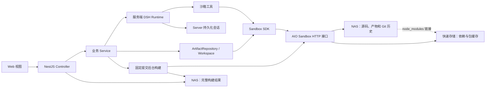

# Artifact Editor

这是一个包含宿主 Web 应用和 NestJS 接口服务的 npm monorepo。

```text
apps/
  web/       React + Vite 宿主界面
  server/    NestJS 分层服务、DSH Agent、Artifact/Session 管理与沙箱代理
packages/
  sdk/
    src/web/       无头 DOM 检查、属性编辑、overlay、React hook 与 Vite Adapter
    src/server/    Sandbox Bash 接口、文件辅助操作、薄 Git 版本封装、可选 Docker 适配器
```

## 元素定位策略

前端模块组织见 [前端宿主说明](apps/web/README.md)。

- HTML + JavaScript 产物不修改 DOM，用户选择元素时采集祖先链路、关键属性、文本和 HTML，并作为运行时 hint 发送给 Agent；
- React/Vue 产物使用 `code-inspector-plugin` 提供 `file:line:column`；
- Artifact 同时保存创建时选择的技术栈和从当前源码检测到的技术栈。启动预览及 Agent 修改依赖后都会重新检测，必要时自动切换定位方式并重启预览。

## 开发

```bash
npm install
docker compose -f compose.sandbox.yaml up -d --build
npm run dev
```

开发模式会同时启动：

- Web：`http://127.0.0.1:4173`
- NestJS：`http://127.0.0.1:4174`

启动前按 [mock-nas 说明](mock-nas/README.md) 配置沙箱地址 `http://127.0.0.1:18081`。模拟环境将源码挂载到项目的 `mock-nas/artifacts`，依赖使用沙箱临时磁盘；原有沙箱地址也可以继续使用。

Vite 会把 `/api`、`/published`、`/absproxy` 和兼容的 `/proxy` 请求转发给 NestJS。

## 构建和运行

```bash
npm run build
npm start
```

生产模式下 NestJS 在 `http://127.0.0.1:4173` 同时提供接口、沙箱预览代理和 Web 静态文件。

Agent 使用 DeepSeek 官方的 [DeepSeek Harness（DSH）](https://github.com/deepseek-ai/deepseek-harness)，在 Server 进程中运行。Agent 通过 SDK 工具调用已有容器，沙箱内只执行文件操作、依赖安装、构建和预览；模型凭据不会传入沙箱。DSH 使用官方 `dsh-llm-pi-ai` 作为模型传输适配器，该包内部的 pi-ai 不是旧的 pi-coding-agent，项目已删除 Pi Agent 的启动与会话实现。

配置示例见 [.env.example](.env.example)。`DEEPSEEK_API_KEY`、`DEEPSEEK_BASE_URL`、`DEEPSEEK_MODEL` 由 Server 读取，同时兼容原有 `API_KEY`、`BASE_URL`、`MODEL`。部署环境变量优先于 `.env`。通过 `ARTIFACT_SANDBOX_URL` 指定已有 AIO Sandbox 的 HTTP 根地址，默认 `http://127.0.0.1:18080`；沙箱开启 JWT 鉴权时，通过 `ARTIFACT_SANDBOX_TOKEN` 提供 Bearer token。Server 使用官方 `@agent-infra/sandbox@1.0.17`，无需 Docker CLI 或 Docker socket。AIO 服务须支持文件、Bash session 和预览代理接口；本项目已在 AIO 1.11.0 上验证。

DSH 接入保持为一个薄封装：构造时传入模型配置和可选的 Cordis 插件，每次 `run()` 传入当前沙箱的工具和提示词。模型请求与工具循环由官方 DSH 核心处理；产物 checkpoint、回滚、预览、依赖缓存和会话展示由业务层处理。

```ts
const harness = new DshRuntimeService({
  sessionRoot: config.sessionRoot,
  model: {
    model: "deepseek-chat",
    baseURL: "https://api.deepseek.com",
    apiKey,
  },
  // plugins: [[plugin, pluginConfig]], // 可选，直接使用 DSH 的 Cordis 插件
});
try {
  const reply = await harness.run(message, {
    sessionId,
    cwd: workspace.root,
    tools: toolService.forWorkspace(workspace),
    systemPrompt: toolService.prompt(workspace.root),
    signal,
  });
} finally {
  await harness.close();
}
```

NestJS 实际复用单个 `DshRuntimeService`，在服务关闭时释放它；工具按每次调用的会话注册，绑定业务编辑流程提供的当前 workspace。`model` 也接受延迟配置函数或 `{ model, provider?, adapter }`，便于注入官方 `LlmAdapter`。官方 [`dsh-sdk-client`](https://github.com/deepseek-ai/deepseek-harness/blob/master/packages/sdk/client/README.zh.md) 通过子进程和 JSON-RPC 驱动 DSH，使用 profile/patch 加载插件，没有直接传入进程内工具函数的接口。这里直接组合官方核心包，以便把 Server 内的沙箱工具传入 Agent。

## 服务分层与存储

NestJS 按 `ArtifactsModule`、`AgentModule` 和 `HealthModule` 组织。模块内分为 `controllers/`、`services/`、`repositories/` 和 `models/`；Controller 处理 HTTP 和创建进度流，Service 编排创建、对话、编辑与 checkpoint，`ArtifactRepository` 负责源码和产物元数据读写。`SandboxModule` 注入官方 `SandboxClient`，集中适配响应、工作区路径与命令生命周期。依赖管理属于 `ArtifactsModule` 的 `DependenciesService`，判断和缓存逻辑在 Server 的 TypeScript 方法中执行；沙箱仅接收文件请求、包管理器和标准系统命令。产物源码与 Vite 配置由 `ArtifactTemplateService` 生成，Server 不再注入 Node 业务脚本。详细目录和职责见 [Server 分层说明](apps/server/README.md)。Web 仍作为视图层，原有 `/api`、NDJSON 创建进度和 HMR 协议保持可用。前端预览使用 AIO 官方 `/absproxy/{port}/`，`/proxy` 入口兼容转发到 `/absproxy`。



`ARTIFACT_WORKSPACE_ROOT` 默认是沙箱内的 `/workspace`，生产中可挂载 NAS。`ARTIFACT_DEPENDENCY_ROOT` 默认是 `/opt/artifact-dependencies`，应挂载本地 SSD 或其他快速存储，必须位于源码根目录之外。两个路径不能互相包含，且必须在同一个沙箱中可见，例如已有容器使用 `/mnt/nas/artifacts:/workspace` 和 `/var/lib/artifact-editor/dependencies:/opt/artifact-dependencies` 两个挂载。

挂载目录需要允许 AIO 的执行用户读写。官方 SDK 默认使用容器的 `gem` 用户，而旧 Docker exec 实现使用 root；迁移已有 root 所有的目录时，应在部署侧按实际 UID/GID 设置目录所有者和 NAS 权限。服务不会自动提权或修改整个挂载目录的权限。

依赖安装会把 package.json、lockfile 和 .npmrc 放到快速存储的暂存目录，运行 npm 或 pnpm 后把成功结果保存为按产物及依赖清单区分的缓存。产物目录的 `node_modules` 链接到该缓存；npm 下载缓存和 pnpm store 也位于快速存储中。源码 lockfile 在创建或编辑时保存，预览和历史版本切换不会改写源码清单及 lockfile。清单变化后重新安装，已有缓存可直接复用。预览所需的框架定位插件作为运行时附加依赖安装，不改写历史源码。

打开预览和开始 Agent 编辑时，`WorkspaceService.ensureReady()` 检查源码目录和运行环境，并验证依赖缓存完成标记、声明的包目录、Vite 命令和 lockfile。沙箱过期或缓存损坏时重新安装并修复链接；恢复使用 `npm ci` 或 `pnpm install --frozen-lockfile`，不改写 NAS 的清单和 lockfile。缺少或不匹配的 lockfile 会明确报错，需要先通过依赖安装流程修正并保存版本。

## 实时预览、版本和分享

编辑时使用沙箱中的 Vite 和 HMR。创建产物以及 Agent 保存新 checkpoint 后，`BuildService` 自动在后台从该次 Git commit 导出独立源码，恢复其依赖并构建；Agent 回复不等待生产构建。独立构建目录由沙箱的 `ARTIFACT_BUILD_ROOT` 指定，默认 `/tmp/artifact-builds`，应使用临时快速存储，与源码、依赖目录分离，结束后删除。

完整 HTML、JS、CSS、图片及构建记录保存到 Server 的 `ARTIFACT_RELEASE_ROOT`，默认 `mock-nas/releases/<artifactId>/<commitSha>/`。Server 直接通过 `/published/<artifactId>/<commitSha>/` 提供页面，成功结果复用，沙箱离线和 Server 重启不会改变已保存页面。这里支持当前 HTML/React/Vue 的 Vite 静态产物；SSR 产物需要独立运行时。

浏览历史使用该版本的构建结果，代码浏览从同一 Git commit 读取，不改变当前工作区。选择“基于此版本编辑”才切换编辑分支，恢复依赖和实时预览；保存后形成新的全局版本。分享按钮返回当前所选已保存版本的固定地址；尚未成功构建时等待或重试。构建失败保留源码版本及其他成功版本，界面显示失败状态，不影响继续编辑。服务停止时未完成的构建记为中断，之后通过历史预览或分享重试。

当前按单用户 Session 编排，后台构建只合并同一提交的重复请求，没有新增分布式锁、任务队列或沙箱供应商管理层。生产平台需让替换后的沙箱重新挂载 NAS，并提供稳定访问地址；地址变化时更新 Server 配置。

使用 pnpm 时，在 Server 设置 `ARTIFACT_PACKAGE_MANAGER=pnpm`，并预先在沙箱镜像中安装 pnpm。该变量只决定未声明包管理器、没有 lockfile 的新产物；已有产物优先按 `package.json` 的 `packageManager` 声明，其次识别 `pnpm-lock.yaml`、`npm-shrinkwrap.json` 或 `package-lock.json`，未设置变量时默认 npm。声明了具体 npm/pnpm 版本的产物要求沙箱安装相同版本。把 npm 产物改为 pnpm 声明后，安装器会在快速存储中用 `pnpm import` 导入旧 npm lockfile，再生成并保存 `pnpm-lock.yaml`，保留原 npm lockfile。

pnpm 使用 `<依赖根目录>/pnpm-store` 共享包内容，每个产物及依赖版本仍有独立的安装目录，文件通过硬链接复用。store 与安装目录都放在快速存储的同一文件系统中，NAS 中只有 `node_modules` 符号链接。当前使用 `node-linker=hoisted` 保持与现有 Vite 预览和 `preserveSymlinks` 配置兼容；不需要在 NAS 中创建 `.pnpm` 包目录。pnpm 版本参与缓存指纹，升级后会重新准备依赖。

Agent 的命令工具设置 `PNPM_CONFIG_VERIFY_DEPS_BEFORE_RUN=false`，防止 pnpm 在运行构建脚本时自动向源码目录安装依赖；修改清单后统一调用 `install_dependencies`。手动在沙箱执行 `pnpm run` 时也应设置此变量，或传入 `--config.verify-deps-before-run=false`。

已有实体 `node_modules` 会在该产物下次准备依赖时迁移到快速存储的 `legacy-*` 目录，再替换为链接。迁移和缓存不会自动清理；生产环境需根据保留的历史版本安排清理策略。根项目依赖安装钩子不会在暂存目录自动运行；第三方依赖安装钩子在沙箱内自动执行，pnpm 设置 `dangerouslyAllowAllBuilds=true` 延续原 npm 行为，使原生依赖可正常安装。需要根项目 prepare/postinstall 的产物应将该步骤放到显式构建流程。当前外置安装支持独立 npm/pnpm 项目，暂不支持 workspaces（含 `pnpm-workspace.yaml`）和本地路径依赖。

DSH 会话保存在 Server 的 `ARTIFACT_SESSION_ROOT`，默认是仓库根目录下的 `.artifact-server/sessions`，生产中应配置持久卷。会话按产物目录隔离，Server 重启后可以继续对话。旧的沙箱内 Pi JSONL 会话保留原位置，本次未迁移其历史格式。

项目的公共 SDK 保留 `Sandbox`、Git 工具和 Docker adapter 的兼容入口；NestJS 的生产执行路径使用官方 AIO SDK。DSH 工具、Workspace 编辑队列、依赖管理和 checkpoint 规则由 Server 管理，模型凭据留在 Server。预览记录官方 Bash session，在切换产物、启动失败和应用关闭时回收进程；固定的受管 session 也支持 Server 重启后回收旧预览。

执行接口、辅助方法与两种 Agent 接入示例见 [SDK 文档](packages/sdk/README.md)。

`npm test` 运行 SDK、宿主版本工作流、DSH 会话与工具调用、外置依赖、NestJS 接口和 Web 回归检查。DSH 测试使用本地模型替身，不请求真实模型。SDK 的真实 Docker 测试通过 `SDK_DOCKER_CONTAINER` 指定容器。设置 `ARTIFACT_SANDBOX_TEST_URL=http://127.0.0.1:18080` 后运行 `npm run test:integration --workspace @artifact-editor/server`，验证官方 SDK 的文件、路径约束、取消、pnpm 缓存与失败恢复，以及 HTML/React/Vue 的创建、构建、版本、预览与真实 HMR 连接。测试直接调用官方 HTTP SDK，使用 `/tmp/artifact-aio-*` 的独立源码/依赖目录，并在结束时清理受管 session 和测试文件；要求沙箱已安装 pnpm、可访问包仓库，且预览端口 5173 空闲。

`npm run test:web:integration` 使用 Chromium 验证首次打开和刷新时预览只加载一次。测试会启动独立的 Web 服务并提供固定接口响应，无需启动业务服务或 Docker；可通过 `ARTIFACT_TEST_BROWSER` 指定浏览器可执行文件。

设置 `ARTIFACT_NAS_TEST=1` 后运行 `npm run test:nas --workspace @artifact-editor/server`，可验证真实 NAS 挂载、固定版本构建、历史代码读取、沙箱停止期间的静态分享，以及重启丢失依赖后的严格恢复和 HMR。该测试只停止/启动 `compose.sandbox.yaml` 的专用模拟沙箱（18081），使用 `mock-nas` 下独立测试目录并在结束时清理，请在该沙箱空闲时运行。
